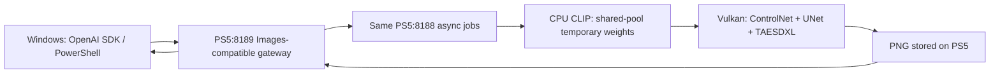

# PS5 AI WAI

2026-10-19: **Fixed IP-Adapter memory lifetimes and completed 1024×1024 manga LoRA + IP reference + OpenPose + masked img2img in 141.357 seconds.** Requested 20 / executed 17 steps; 0 changed pixels outside the mask; OpenAI-compatible and native PNGs matched. Direct 9422MiB, FP32 and GPU driver settings were preserved. [IP fix and measurements](docs/ip-lifecycle-20261019.md) · [Feature verification scope](docs/feature-classification-20261019.md). Reference identity, requested colors and editing quality still need improvement. Operator recovery of PNGs after a disconnect and 6 consecutive 1024/20-step short-prompt jobs (124.176–124.446 seconds) were verified. This does not establish exact reproduction of the original long-prompt catalog, 24-hour operation or all parameter combinations.

[Operations and recovery scope](docs/operations-recovery-20261019.txt) · [Operational measurements](docs/operations-recovery-20261019-evidence.json). A standard OpenAI client cannot discover an unknown job after disconnecting before receiving its ID. Do not automatically resend a POST with an unknown outcome.

Representative 1024 console tests also covered grayscale soft masks, full-edit masks and masks with Canny (98.782 / 75.634 / 151.549 seconds). Partial-mask preservation passed, but the requested semantic change to a red skirt was not achieved. Different initial states and features prevent deriving a speedup from these 3 values.

2026-10-19: **Deployed masked img2img / inpainting to the console.** Grayscale 256 took 63.217 seconds; alpha PNG + manga LoRA + OpenPose 1024 took 172.897 seconds. Every RGB pixel outside the mask matched the source, and Windows retrieved the PNG through the OpenAI-compatible API. Requested color changes were not achieved, so visual quality was not marked as passing. [Scope and limitations](docs/masked-inpainting-20261019.md) · [API](docs/mask-api.md). No further verification videos will be recorded.

Additional measurement, 2026-10-19: **1024×1024 generation from an unloaded model decreased from 184.026 to 161.397 seconds: 22.629 seconds (about 12.3%).** Same WAI + manga LoRA + OpenPose, 20steps; PNGs matched byte for byte. Each observation was 1 image after an app restart; OS file caches were not cleared. [Conditions and measurements](docs/optimization-20261019.md) · [12-second first-generation success video](docs/media/optimization-openpose1024-cold.mp4).

2026-10-19: **Reduced duplicate CLIP work, reused UNet invariants, batched ControlNet CFG and updated memory allocation.** Final Direct pool 9422MiB (about 9.201GiB); CPU CLIP weight groups target 16MiB. First 256 with OpenPose + manga LoRA 1/20steps decreased from 124.567 to 115.815 seconds. In the same process, switching 256→1024 took 132.952 seconds and repeating 1024 took 117.600 seconds, with reference PNG identity. The 2 values, 132.952 and 117.600 seconds, have different conditioning-cache states and are not a speedup comparison. [Comparison, memory and scope](docs/optimization-20261019.md) · [12-second success video](docs/media/optimization-openpose1024.mp4).

2026-10-19: **Fixed UNet phase measurements and log synchronization.** The same first OpenPose 1024 request decreased from 194.54 to 184.03 seconds with identical PNGs. Combined pool/startup fsync time decreased from 12.73 to 0.33 seconds. Each condition was observed 1 time. [Phase timings, conditions and limitations](docs/unet-profiling.md) · [12-second API success video](docs/media/controlnet-openpose1024-logsync.mp4).

Aligned BGRA rendering with the VideoOut format and deployed the fix for the magenta display tint. The user confirmed that TV colors were corrected. The home screen still showed its old cached icon despite updated image files; icon display refresh is not considered verified.

2026-10-18: **Verified Canny / OpenPose ControlNet generation at 256 and 1024 and PNG retrieval through the OpenAI-compatible API on PS5.** Supports a 9GiB Direct pool in 512MiB regions and shared-pool temporary CPU CLIP weights. Home-screen and status-display image files were updated to the user-provided character. The home screen still displayed the old icon.
[Measurements, limitations and model placement](docs/controlnet.md) · [API](docs/api.md).

| 1024×1024 /20steps /manga LoRA 1 | PS5 generation |
|---|---:|
| Canny | 162.56 seconds |
| OpenPose | 329.68 seconds |

This table contains 1 functional observation per condition from 2026-10-18. Log synchronization explains part of the OpenPose delay, but separating GPU compute from internal waits and addressing first-run fragmentation remain open. See the phase records above for the latest matched-condition comparison.


[12-second Canny success video](docs/media/controlnet-canny1024.mp4) · [12-second OpenPose success video](docs/media/controlnet-openpose1024.mp4). These show completion excerpts from actual Windows operation; 12 seconds is not the generation time.



Earlier manga LoRA 256 tests are in the [historical record](docs/manga.md). The current default manga LoRA strength remains 1; automatic monochrome is disabled by default.

Updated the status screen to navy and mint cards. CPU rendering displays smooth text, progress, available memory measurements and logs.
[Dashboard and console verification](docs/dashboard.md) · [16-second success recording](docs/media/dashboard-success.mp4). Unavailable utilization and temperature measurements are omitted.

2026-10-18: Separated normal/debug logging and limited primary continuous logs to a combined 64MiB.
WAI 768×1024/20steps took 92.47 seconds initially and 57.06 seconds with the model loaded, with identical PNGs.
The following 8 different-prompt images took 72.34–72.42 seconds on PS5. See [Logging and performance](docs/logging.md) for conditions, cache differences and console evidence.
Without pausing generation, another 6 consecutive images completed in 70.62–70.69 seconds. The slowdown after image 4 did not recur in these 6 observations.

<p align="center">
  
</p>

<p align="center"><strong>Generate WAI images on the PS5 GPU. Retrieve PNGs over HTTP from Windows.</strong></p>

A developer-oriented project running **WAI-Illustrious-SDXL v17.0** as a native application on a jailbroken PS5.
Connects `stable-diffusion.cpp / GGML → Vulkan → PS5 RADV / AGC`, with an image-generation API and TV status display.
Windows handles builds, transfers and API requests. Model inference runs on the PS5 itself.

**GPU generation and Windows PNG retrieval are verified on FW 12.40.** Tests cover up to 1024×1024, including manga LoRA and ControlNet.
This is an experimental port. Other firmware, consoles and launch environments are untested.


The preview above runs the same rendering code on Windows with synthetic data and the supplied character. It is not a PS5 HDMI screenshot.
The console displays only available measurements, so its card count and values may differ.

## Generated images

<p align="center">
  
</p>

WAI v17.0 / 1024×1024 / Euler ancestral / 20 steps / CFG 5 / seed 135792.
Used CPU CLIP, GPU UNet and Flash Attention, then TAESDXL decoding. This does not imply full-VAE image quality.

[](docs/media/verified-results.mp4)

**[Watch the 25-second results video](docs/media/verified-results.mp4)** — a retrospective Windows recording displaying actual PNGs and measured logs.
It is not live-generation footage or PS5 HDMI capture. If GitHub cannot preview it, download it from the video page.

## Performance improvements before LoRA integration

Batched 20-step CFG with batch 2, reducing UNet calls from 40 to 20. The adopted configuration is **FP32 computation + batched CFG**.

| Model loaded, repeated matched conditions | Previous FP32 | Batched CFG |
|---|---:|---:|
| 256×256 / 20 steps | 35.44 seconds | **14.62 seconds** |
| 1024×1024 / 20 steps | 84.09 seconds | **79.27 seconds** |

The 256 PNG matched the original byte for byte. The 1024 PNG passed retrieval, visual review and NaN/Inf checks. The 6GiB Direct reservation was preserved.
FP16 physical capabilities, `fp16: 1`, actual GPU readback and WAI 1024 generation were verified, but this configuration was slower and is not the default.
See the [FP16/CFG comparison](docs/precision.md) and [short verification video](docs/media/precision-cfg-verified.mp4) for separate first-run/warm measurements and limitations.

[](docs/media/precision-cfg-verified.mp4)

## Earlier verification


Performed in one native process on 2026-10-18 JST. Times cover model loading, inference and decoding inside the app, and the Windows wait until the response arrived.

| Image size / steps | Model state | PS5 generation | Windows PNG retrieval |
|---|---|---:|---:|
| 256×256 / 8 | Including initial load | 43.23 seconds | 44.52 seconds |
| 1024×1024 / 20 | Loaded | **91.65 seconds** | **93.09 seconds** |

An earlier matched-condition test in the same process measured 1024×1024/8steps at 65.03 seconds initially and 34.12 seconds warm.
Those records used different generation settings/software, so no direct speed ratio against the 20-step measurements above is derived.
An exactly matched comparison against another PC has not been performed.

- Startup **GPU Compute readback verifies 64MiB against CPU results**. It does not test the entire reserved 6GiB.
- Sampled completed UNet weight computation and Flash Attention during generation. The 1024 counter deltas were 138,826 dispatches, 29,518 submissions and 29,518 completed fences. These are not GPU-utilization measurements.
- **6GiB** Direct data pool; owned-pool peak about 5.06GiB during 1024 generation. Process peak RSS about 8.38GiB may include shared mappings and must not be added to it.
- Native API, OpenAI response and PowerShell PNG SHA 256 values matched.
- Both APIs returned to ready after generation. FTP, Telnet and WebSrv were preserved; verification did not update firmware or write system areas.

Detailed measurements and limitations are in the **[verification record](docs/verification.md)**; machine-readable values are in [verification.json](docs/verification.json).
This source release supports rebuilding with reviewed dependencies. Reproducing every dependency from scratch and registering an app for the first time are not yet generalized.

## Using it from Windows

Requires the native PS5 application and APIs to be running already.
The OpenAI-compatible adapter is a separate PS5 process on 8189. Existing WebSrv 8080 and native async API 8188 remain in place.

```powershell
# Set your PS5 private IPv4 and a separately created token file
.\scripts\Invoke-WaiOpenAI.ps1 `
  -BaseUrl 'http://192.168.1.100:8189/v1' `
  -TokenFile 'D:\ps5-private\api-token' `
  -Prompt 'masterpiece, best quality, cute adult manga girl, gentle smile' `
  -Width 1024 -Height 1024 -Steps 20 -Seed 135792 `
  -OutputDirectory 'D:\PS5-AI\output'
```

Add `-ListModels` to inspect models without running inference.

```python
import base64
from pathlib import Path
from openai import OpenAI, DefaultHttpxClient

client = OpenAI(
    base_url="http://192.168.1.100:8189/v1",
    api_key=Path("D:/ps5-private/api-token").read_text().strip(),
    max_retries=0,  # Avoid duplicate generation after a timeout
    timeout=1800,
    http_client=DefaultHttpxClient(trust_env=False),
)
image = client.images.generate(
    model="wai-illustrious-sdxl-v17.0",
    prompt="cute adult manga girl, front view, gentle smile",
    size="1024x1024", n=1, response_format="b64_json",
    extra_body={"steps": 20, "cfg_scale": 5, "seed": 135792, "sampler": "euler_a"},
)
Path("wai.png").write_bytes(base64.b64decode(image.data[0].b64_json, validate=True))
client.close()
```

Supports **part of the OpenAI Images generation API**: 1 PNG, without streaming.
Representative img2img, IP-Adapter, masked images/edits and Canny/OpenPose cases passed GPU generation and PNG retrieval up to 1024. Combined IP + manga LoRA + OpenPose + masking also passed. Reference identity, requested colors and editing quality need improvement. Soft masks apply to final RGB compositing; diffusion masks are binary. Multiple outputs, transparent output, JPEG/WebP output and ComfyUI/A1111 APIs are unsupported. See [feature scope](docs/feature-classification-20261019.md).
See the [API](docs/api.md) and [OpenAPI 3.1](docs/openapi.json).

## Implementation and builds

| Location | Contents |
|---|---|
| [`native/app`](native/app) | Native launch, GPU checks, Direct pool, engine integration, async API, bounded logging |
| [`native/runtime`](native/runtime) | Direct-memory thread stacks, C++ allocation, TLS teardown |
| [`native/ui`](native/ui) | VideoOut status screen: clock, heartbeat, available memory measurements and logs |
| [`native/gateway`](native/gateway) | CPU-only OpenAI adapter forwarding to 8188 on the same PS5 |
| [`native/link`](native/link) | Native CRT, public API stubs, linker configuration and compatibility functions |
| [`patches`](patches) | SD/GGML and RADV sources and modifications |
| [`tools`](tools) / [`build-profiles`](build-profiles) | Configurable build paths and dependency verification |
| [`scripts`](scripts) / [`tests`](tests) | PowerShell clients and host tests without model inference |

**[Build and reproducibility scope](docs/build.md)** → **[Deployment and operation](docs/deployment.md)** → **[Models and licenses](docs/models.md)**

Primary continuous logs retain 2 generations within a combined 64MiB limit, separate from bulk data storage.
Fatal errors set API failed/degraded status and reject new generation with 503.
Unknown GPU resources are not automatically freed, and generation POSTs are not automatically retried.

Console APIs verified screen presentation and heartbeat updates. TV colors/text clipping and home-screen icon-cache refresh still require separate visual checks.
Unavailable utilization and temperature fields are omitted.

## Credits and licensing

This project ports and integrates existing open-source implementations. It does not claim original authorship of the image model or Vulkan driver.

- [stable-diffusion.cpp](https://github.com/leejet/stable-diffusion.cpp) / GGML — image inference, MIT.
- [PS5_Vulkan](https://github.com/mihawk-99/PS5_Vulkan) / [PS5_Mesa](https://github.com/mihawk-99/PS5_Mesa) — PS5 GPU implementation, native tooling and RADV. Preserve each source's GPL/MIT and other notices.
- [PS5 Payload SDK](https://github.com/ps5-payload-dev/sdk) / [PS5_PayloadSDK fork](https://github.com/mihawk-99/PS5_PayloadSDK) — public SDK and platform implementation.
- [cobanov/PS5LM](https://github.com/cobanov/PS5LM), [mansanitizer/psllama](https://github.com/mansanitizer/psllama) — references and comparisons for proven native launch, memory and display handling.
- [ps5-payload-dev/websrv](https://github.com/ps5-payload-dev/websrv) — reference for the existing deployment and launch route.
- [WAI0731 / WAI-Illustrious-SDXL](https://civitai.com/models/827184?modelVersionId=2883731) / [TAESD](https://github.com/madebyollin/taesd) — obtain models separately; weights are not included in this repository.

The integrated application is licensed under **GPL-3.0-or-later**. Preserve file-level MIT and other licenses and copyright notices.
Model terms are separate from the code license. See [Third-party notices](THIRD_PARTY_NOTICES.md).
No official Sony SDK, firmware, keys, jailbreak exploits, authentication tokens or personal logs are distributed.
