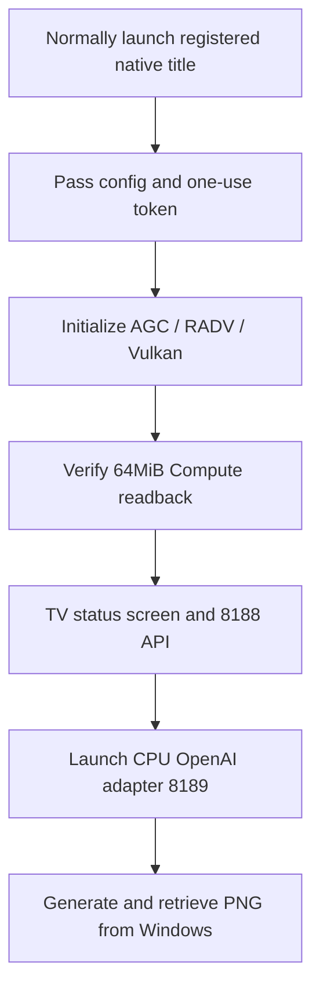

# Deployment and operation

Uses the verified FW 12.40 environment with native Homebrew launch already available.
This is not an installer automating initial registration, jailbreak or compatible payload installation.
Copying eboot through FTP alone cannot launch an unregistered title on a PS5 without an existing launch environment.

## Verified layout

```text
/data/ai/
├── models/                         Original models
├── output/                         Verified PNG storage
├── openai-gateway/                 CPU adapter config, jobs and outputs
└── native-wai-direct/PPSA99188/
    ├── eboot.bin
    ├── sce_sys/param.json          PS5 AI WAI
    ├── sce_sys/icon0.png           Adopted WAI-generated icon
    ├── sce_module/libc.prx         Existing verified public runtime
    ├── models/                    Native /app 0/models
    ├── licenses/
    └── ai-runtime/                Native /app 0/ai-runtime
        ├── config.json
        ├── config/api-token       Present only during startup
        ├── jobs/
        ├── output/
        └── logs/
```

This registered title uses an existing application alias. No mounts or system metadata were changed during this update/verification.
Automatic creation of that alias on arbitrary PS5 systems is not published.
Do not overwrite title ID PPSA99188 if another app uses it.

## Deployment prerequisites

Requires an already registered native app and normal public SystemService launch/close paths.
The verified version does not rely on LaunchApp arguments; native API paths and bind IPv4 are fixed at compile time.
**Change `native/app/server.c` `bind_ip` to your private IPv4 and rebuild.**
The public source default is the test console's private address. Do not replace it with 0.0.0.0 or a public IPv4.

Launch the gateway with `--root /data/ai/openai-gateway --bind <PS5_IP> --port 8189`.
It forwards to 8188 on the same bind IP; configure matching addresses.
Existing WebSrv 8080 is preserved; image generation is not added to WebSrv itself.

## Configuration and secret tokens

Use [config/native.json.example](../config/native.json.example) as the engine configuration baseline.
Verify actual model-copy sizes and full-content SHA values. Never replace a file with another model under the same name.
Runtime/config directories require application UID 1 and 0700; tokens require 0600 and 32–256 printable ASCII characters.
Never include tokens in source, URLs, Git or shared screenshots.

Native bootstrap waits for configuration and a one-use token.
In the existing environment, pass configuration/token only after verifying owner, start time, title and boot; restore UID 1/0700 before releasing the app.
Leaving root ownership in place while GPU work continues prevents application writes.
This shsrv uses numeric `chown 1 PATH`, not `1:1` syntax.
Verify the actual owner through FTP metadata, not merely the SDK stat UID field.

## Startup sequence



Check authenticated `GET /health`. Do not repeatedly generate while GPU unavailable or degraded.
Models load on the first generation and remain in the same app. The first load is required again after restart.
This does not eliminate weight staging or graph-segment transfers during generation.

## Logs and recovery

| Location | Limit and purpose |
|---|---|
| `/download0/ai-native-bounded-logs-v2/` | startup / driver / pool: 4MiB×2 generations each, 24MiB combined maximum |
| `/app0/ai-runtime/logs/engine.jsonl` | Engine results: 16MiB×2 generations |
| `/app0/ai-runtime/` | Bootstrap, API, jobs and images on the data side |

Inspect a known job_id instead of regenerating solely because HTTP timed out.
In a retained state, do not free/reuse uncertain GPU resources. Verify the app ID, PID and start time, then use normal OS close.
Native shutdown 409 indicates that a stalled worker cannot safely be joined.
Stopping the gateway does not stop the native GPU application.

If console/services are unresponsive, do not automatically launch overlapping payloads or apps.
After console recovery, start the existing FTP/Telnet/WebSrv and inspect saved logs and model/title placement.
Do not manually release Direct Memory, change budgets or rewrite system files without identifying the stop cause.
Firmware updates, initialization and external exposure are outside this operating procedure.
