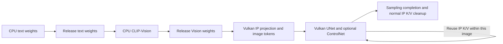

# IP-Adapter memory-lifetime fix and console verification (2026-10-19)

V18 successfully generated 1024×1024 with WAI-Illustrious-SDXL v17.0, manga LoRA, IP-Adapter, OpenPose and masked img2img. OpenPose remained loaded from the preceding request; CPU text conditioning was actually recomputed. Windows OpenAI-compatible and native API PNGs matched.

The fix did not change Direct reservation, GPU driver, shaders, precision or API. Reservation remained 9,879,683,072 bytes (9,422MiB, 9.201171875GiB). Target FW 12.40; no system-area writes. Measurements/scope are in [ip-lifecycle-20261019-evidence.json](ip-lifecycle-20261019-evidence.json).

## Changes

Changed 2 inference files: `core/diffusion_engine.cpp` and `core/image.cpp`.

- Made IP projection and 140 UNet weights named with prefix `model.diffusion_model.` and suffix `.attn2.to_k_ip.weight` or `.attn2.to_v_ip.weight` reloadable Disk residents on the same Vulkan backend. UNet IP 650MiB and projection approximately 158.24MiB can be freed through normal ownership, pin and runner cleanup. Base WAI, LoRA and ControlNet residency policies are unchanged.
- Run CLIP-Vision after CPU text conditioning and its runner cleanup, separating the two encoders' shared-Direct weight lifetimes while preserving constructed conditioning tensors.

Preserved 2048×16 IP token shapes, finite checks, GPU execution witnesses, graph-capacity checks and ownership preventing active-weight release. Host dependency checks verified no bulk IP-weight load for graphs without references or IP strength 0.

## Allocation-failure cause

The earlier V17 request failed with `no_contiguous_region` at CPU Vision chunk 3. Rounded request 265,863,168 bytes; total free 334,872,576, largest region 81,952,768. This directly establishes fragmentation for the first refusal.

Measured total Vision weights 1,223,917,568 bytes also exceeded 862,912,512 free before allocation. Shrinking only the first chunk would not solve later capacity requirements. Fixed unnecessary IP residency and encoder lifetimes rather than increasing reservation.

The refusal preceded that request's UNet/ControlNet inference and is not a GPU-compute or driver failure. Logs confirmed returned CPU chunks after the error. No failure images or raw failure logs are attached.

## Combined 1024×1024 result

Requested 20 steps, CFG 5, `euler_a`, seed 20261018, manga LoRA 1, IP 0.3, OpenPose 1, denoise 0.8; actual 17 steps. Used 4 inputs: reference image, initial image, prepared pose map and alpha-derived mask.

|Check|Measured result|
|---|---:|
|PS5 generation time|141.356660 seconds|
|Finite-checked UNet outputs|34|
|ControlNet evaluations|34|
|IP image tokens|16|
|Nonfinite values|0|
|Mask applications|17|
|Pixels outside edit region|944,203|
|Changed outside pixels|0|
|Direct usage peak|9,313,894,400 bytes|
|Remaining reservation at peak|565,788,672 bytes|
|Final Direct usage|8,169,750,528 bytes|
|Final CPU-weight Direct borrowing|0 bytes|
|Retained Direct fault|None|

Verified GPU IP attention, UNet and ControlNet execution. Exactly 1 generation POST, no automatic retry. PNG SHA 256 `8cc8fa0157cea42d3c29afc13a7b7e45052fde0772acadbee0ab8fe75056c8dd`; OpenAI-compatible/native PNGs matched byte for byte.

Direct peak is pool highwater including CPU borrowing, not whole-GPU VRAM usage. Positive remaining capacity does not guarantee arbitrary larger models/combinations.

## Verified CPU-weight returns

Success did not skip expensive work using only cached text conditioning. Text weights: 222 allocations/222 frees; simultaneous borrowing peak 1,535,901,696 bytes. Conditioning took 14.12 seconds; Vision allocation began after borrowed live bytes reached 0.

Vision then performed 5 allocations/5 frees, peak 1,223,917,568 bytes, final 0. Same app owner and already-loaded OpenPose as before; ControlNet weight preparation totaled 0.019155 seconds across 34 calls. Success did not rely solely on a fresh launch that freed ControlNet first.

This combined UNet graph had 17 segments: 34 UNet evaluations required 578 weight-preparation calls totaling 4.856502 seconds. Segment preparation-call count is not actual file-reload count.

## Reading performance comparisons

|Condition|Initial model state|Generation|Total UNet compute calls|Total UNet weight preparation|
|---|---|---:|---:|---:|
|V17, IP 0.3, no LoRA/ControlNet, 20 steps|Loaded|95.858981 seconds|72.312563 seconds|0.075656 seconds|
|V18, same request|Unloaded|126.310573 seconds|84.955169 seconds|16.591327 seconds|
|V18, IP 0.7+OpenPose, no LoRA, 20 steps|WAI loaded, first ControlNet|146.822596 seconds|72.402095 seconds|1.855557 seconds|

The first 2 PNGs shared SHA 256 `6e3710803a600a61750721be8aa026478237fde7277c12cd292609120143ed3e`. V18 lifetime/order changes did not change this output.

However, the first 2 rows have different initial states; 126.31 versus 95.86 seconds is not steady-state regression evidence. V18 first sampling included 1 weight load of 16.46 seconds, absent in warm V17. The additional 16.52 seconds of preparation has matching evidence; the extra 12.64 seconds in compute calls lacks direct clock/shader-compilation measurements and its cause remains unknown. A different loaded V18 request totaled 72.40 seconds in UNet compute calls.

Measurements are CPU-observed elapsed times including internal waits, not pure GPU compute. Nested fields cannot all be summed. Combined 141.36 seconds executes 17 steps and cannot be directly compared as a speedup against the 20-step table.

## Are 650MiB reread at every step?

Not in verified requests. UNet `compute` uses `auto_runner_end=false`; segment ends only restore pin counts, with runner cleanup after sampling. First V18 sampling loaded 1 time. The next IP+OpenPose request loaded 2 times: new ControlNet 7.29 seconds and UNet IP 1.77 seconds; no more loads during 40 subsequent UNet evaluations.

IP weights are freed per image, so the next IP image incurs 1 reload. Permanent pins would deprive the next CPU encoder of space. No new permanent pin was added based on an unobserved per-step-reload hypothesis.

`weight_tensor_copy_set`:67 calls/2,449,036 bytes excludes major `ModelLoader` file-loading routes. It is not total model-transfer volume.

## Host checks and public build

Passed 45 ownership/pin/release checks, 12 graph-dependency checks without IP and syntax checks for 2 changed translation units. Preserved frozen V18 source and fully rebuilt through public instructions from an external checkout. Checked 128 snapshot hashes, patch application/full-overlay reconstruction, SELF structure, pre/post-strip load regions, runtime providers, constructors, dependency archives and source inputs.

Console-tested SELF SHA 256 `512c3d9e04b2d520d2847c89c61e228a05948bfb8893cc097aad2b49338f6c5b`; separately rebuilt public SELF `20256bca2cb607bef806e36f5b9e22b0052fbd8963cae7be5bb078ba2f72c98a`. These are different binaries; the public-procedure SELF itself was not PS5-executed. Distinguish host build success from the verified artifact.

Execution, finite values and outside-mask preservation passed. Generic SDXL IP-Adapter's face/outfit/style preservation remains a quality issue. Completion/PNG retrieval does not establish identity or intended-edit success. See [feature verification](feature-classification-20261019.md) for other masks and continuous-operation coverage.

## Recovering results after a disconnect

Verified 1 disconnect during generation. Closed at GPU sampler progress 0.32 (at least 6 completed steps out of 20); PS5 still finished in 142.042663 seconds.1 POST, 0 automatic retries; separately recovered gateway/native PNGs matched. This did not receive the disconnected synchronous response and was not cancellation, power-loss or GPU-fault recovery.

## 6 consecutive jobs and normal app restart

Generated 6 WAI+manga LoRA+OpenPose 1024×1024/20steps jobs in A/B/C/A/B/C order: 124.176–124.446 seconds, median 124.199. Last 3/first 3 median ratio 1.0001106; no 4–5× slowdown here. All passed GPU finite checks, CPU borrowing return and same-prompt PNG identity. Final Direct usage stayed 8,170,340,352 bytes. Short 258–260 UTF-8-byte prompts differ from the original 768×1024, approximately 1.7–2.0KB catalog; this is not exact reproduction.

Operational process-lifetime Direct peak 9,705,046,016 bytes left 174,637,056 (about 166.55MiB). This is separate from the earlier all-features 1-job peak and includes CPU borrowing. Do not sum these as per-image dedicated VRAM.

The operator found the disconnected job ID in existing internal logs. No API reliably discovers an unknown accepted job for a normal synchronous client disconnected before its ID. Correlation IDs/idempotency remain candidates; unknown POSTs are not automatically resent. The next normal OpenAI generation succeeded in the same process.

Normal OS restart verified synthetic queued/running records becoming failed, preserved existing PNGs and startup 64MiB Compute readback. It did not forcibly interrupt real GPU work or establish GPU-hang/sudden-power-loss recovery.6 jobs cover representative regression, not 24 hours, the full catalog or all parameter combinations.

[Console operations and recovery](operations-recovery-20261019.txt) · [Machine-readable data](operations-recovery-20261019-evidence.json).
