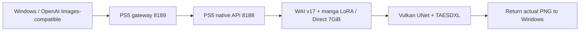

# Manga LoRA and 7GiB Direct console success (2026-10-18 JST)

Applied imge's "manga | Illustrious Style Lora" to WAI-Illustrious-SDXL v17.0. The existing 8188/8189 model/request now defaults to manga LoRA strength 1.0 and monochrome.

Compared identical prompt/negative_prompt at 256×256 /20 steps /CFG 5 /Euler A /seed 20261018.
| Condition | PS5 generation | Windows PNG retrieval | Reported GPU peak | Process RSS peak |
|---|---:|---:|---:|---:|
| No LoRA: initial WAI load included |38.187526 seconds |39.219 seconds |4.877GiB |9.429GiB |
| LoRA: WAI loaded, initial LoRA load included |22.828582 seconds |23.578 seconds |5.374GiB |9.606GiB |

**Different initial-load states prevent claiming a LoRA speedup.** The first run may include GPU cache preparation. RSS may include shared GPU mappings; it is not CPU-only memory and must not be added to the GPU-labelled peak.

Both 2 jobs completed with gpu_used=true and full PNG decode. OpenAI-compatible/native GET PNGs matched byte for byte. Manga LoRA applied 774/774 text-encoder and 2250/2250 UNet tensors: 3024/3024 total, 0 incompatible skips.20 UNet output checks found 0 NaN/Inf. Completed GPU UNet/Flash Attention witnesses and submit/fence completion also passed.

The no-LoRA image was also monochrome; this does not prove a color-to-monochrome transition. Applied-LoRA logs and output differences were observed. Small-image visual review does not guarantee 1024 manga quality or identity lock.

## Measured memory

Direct data pool 7,516,192,768 bytes (7GiB),28×256MiB. Preserved 6.75GiB model-manager budget and 1GiB initial admission reserve; not a dedicated 1GiB CPU pool. Startup 64MiB GPU Compute readback matched, not a readback test of all 7GiB.
After LoRA generation: Direct live 5,664,784,384 bytes, peak 5,725,995,008, free 1,851,408,384. Reported GPU peak also includes driver-side usage.
CPU heap: final mapped 2,367,422,464 bytes, peak mapped 2,536,374,272, libc fallback 0. Internal heap free space was unavailable.
AvailableDirectMemorySize query succeeded; final largest contiguous span 2,076,180,480 bytes (about 1.934GiB), not total free space. Query canaries matched.

## API and operation

Existing OpenAI-compatible 8189 requests require no manga field. Native 8188 accepts manga_strength=0 for comparison, finite 0..1.5, default 1.
Safely stopped the catalog at 217 completed images and normally OS-closed the old native title. Backed up SELF/config under /data/ai and D; normally launched the new app 1 time while retaining gateway/FTP/Telnet/WebSrv.0 firmware updates, direct system writes or manual GPU releases.
After 2 verification images, resumed the original catalog with manga LoRA now default. Existing images were not regenerated. Recorded the boundary in catalog manga-style-boundary-20261018.json.
Saved PNGs in native runtime output and /data/ai/output.
Separate img2img/IP-Adapter source, ELF and weight-header research was complete, but image-input API integration and PS5 reference generation were not yet implemented/verified.

## Weights and reproduction

Original author imge: https://civitai.com/models/1745962?modelVersionId=1976014. Preserve attribution; do not bundle weights in public GitHub.
Mathematically converted legacy GLoRA to WAI-specific standard LoRA rank 48/F32, without SVD/rank truncation. With clip_skip=2, excluded 6 unused final CLIP-L targets; all 1008 used layers matched sampled float 64 reference corrections.
Converted SHA 256: `764e32941b1a6fb4148cc2f700306f36d34c731238c3643249ecc15b29871f68`.
Console SELF SHA 256: `0eaebfeabdebcc81a40af57b6ad210887f5d73f83548f72f1aaf0241765176d3`.

Video records live Windows API operation and PNG retrieval. The 24-second excerpt cuts some waiting without changing playback speed; the full 91-second recording is retained. Neither is PS5 HDMI footage.

To roll back, verify current PID/start/app ID and idle state, normally OS-close, restore hash-verified backed-up SELF/config and launch normally. Do not modify running files or repeat ambiguous launches/generations.

## Images and recordings

[24-second live verification excerpt](media/manga-verification.mp4), with some waiting omitted.

## Public-source rebuild

Rebuilt 11 native translation units, RADV platform and core runner. SELF integrity passed; 24 constructors and dynamic imports/providers matched the console version. Public-source parser 10, pool 26 scenarios and conversion algebra 25 checks passed. This separately identified public SELF was not redeployed. [Rebuild record](manga-build-verification.json).
