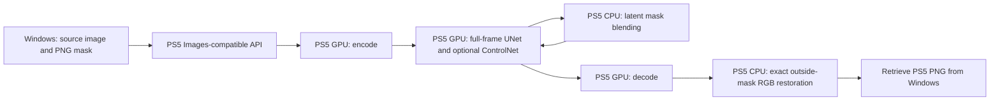

# Masked img2img / inpainting console verification (2026-10-19)

Using WAI-Illustrious-SDXL v17.0, executed each masked `POST /v1/images/edits` case 1 time on PS5. Windows only prepared/transferred inputs, called APIs, retrieved PNGs and compared pixels, without model inference.

|Output|Mask|Combined features|PS5 generation|Outside changes|Inside changes|
|---|---|---|---:|---:|---:|
|256×256|Grayscale|Manga LoRA 1|63.217 seconds|0 changed /59,009 preserved pixels|6,527 pixels|
|1024×1024|Alpha PNG|Manga LoRA 1+OpenPose|172.897 seconds|0 changed /944,224 preserved pixels|104,352 pixels|

Both requested 20 steps and executed 17 at denoise 0.8, CFG 5, Euler A, seed 20261018, without automatic monochrome.256 started unloaded; 1024 enabled ControlNet. Different model composition/resolution/load scope prevents a speedup ratio.1 functional observation each is not long-run stability evidence.

Verified mask preparation, 17 latent blends, completed GPU UNet and finite outputs, 0 NaN/Inf.1024 also verified GPU OpenPose and 10 residual tensors. OpenAI/native PNGs matched byte for byte. CPU CLIP Direct borrowing and input leases returned to 0; test inputs were retrieved. Finally verified both APIs idle, screen updates and existing services.

**Preservation and in-mask changes passed, but the requested red skirt was not achieved.**256 remained dark blue/black; 1024 remained teal, mainly changing folds/shading. Both were visually inspected without passing requested color/final quality. Outside-mask face/hair/clothes/background matched source RGB. This did not verify new-face generation or identity-lock quality.

Masked img2img uses a normal WAI checkpoint, without a dedicated inpainting model. Full-frame UNet runs on GPU; latent/final RGB blends run on PS5 CPU. This is not ROI-only inference, and smaller masks do not imply proportionally less computation.

Preserved 9422MiB Direct (about 9.201GiB),8.75GiB inference budget, 1GiB initial CPU reserve, roughly 16MiB CPU CLIP groups, FP32 and GPU driver/settings. Pool peak includes CPU borrowing, not dedicated VRAM; do not add RSS.

Binary grayscale/alpha masks were console-tested. Soft-edge quality, simultaneous IP-Adapter and full-edit console generation were untested here. Host metadata checks without inference verified that full-edit latent blending correctly permits 0 evaluations. Protocol support does not guarantee every combination's memory fit or quality.

Each condition used 1 generation POST and 0 retries. Under the user's policy, no further verification videos: retain images, prose, measurements and logs instead. The supplied character was not added to the public repo.

[Mask API](mask-api.md) · [Measurements and evidence hashes](masked-inpainting-20261019-evidence.json). Public-source rebuild and executed SELF are distinct artifacts.
